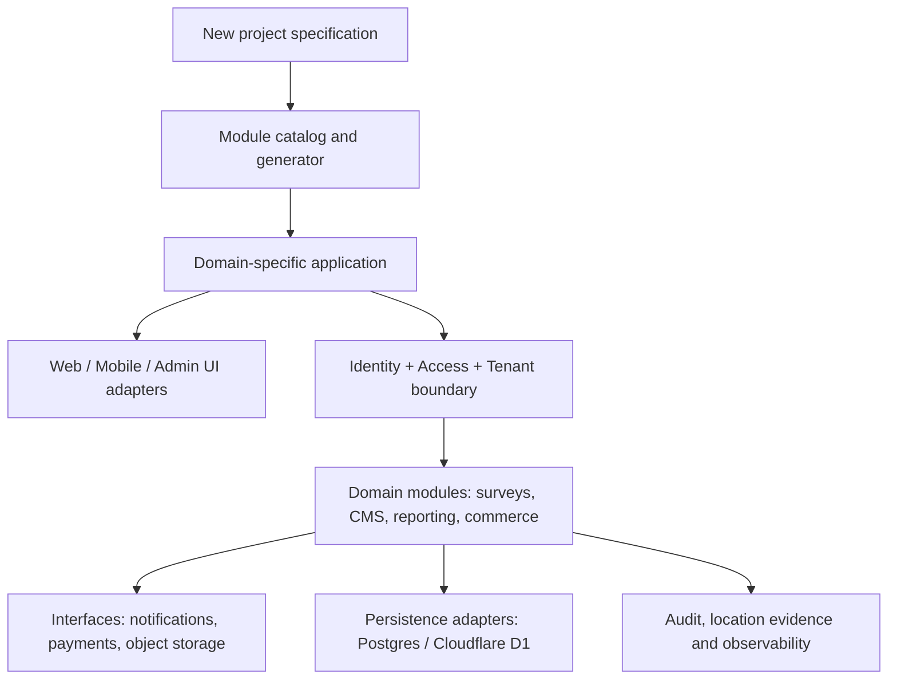

# Architecture and selection model

**Composition choices:** `authorization/simple` is appropriate for small admin/customer/operator portals; `authorization/scoped` adds *multiple functional roles + app features + geography ownership*. Keep geography and functional responsibility independent: permission to edit a field report does not itself grant access to another district. Both authorization modes require authenticated identity from the consuming app.

`admin` uses **operations** (Jnapanam-like) or **governance** (SST-like) navigation presets. Apps may use both, filter by permission, and add product-specific screens. `notifications` selects one or more adapters for SMTP/email, SMS, WhatsApp, push and in-app. `reporting` supports predefined metrics or allowlisted ad hoc dimensions; never execute user-supplied SQL.

`tenant` must be enforced in the query layer and jobs, not just in frontend menus. PlayNexa's three hosting options are deployment arrangements, **not capability tiers**. Single tenant and shared SaaS must behave identically from a feature perspective and maintain strict data separation.

**Avoid genericizing everything:** Booking slot capacity, product inventory, community donations, wedding vendors, vegetables cut sizes, and printing 3D quotations are domain modules owned by their applications. Promote them into this library only after two distinct consumers demonstrate a stable contract.
