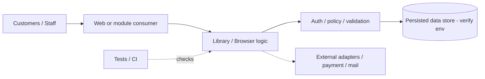
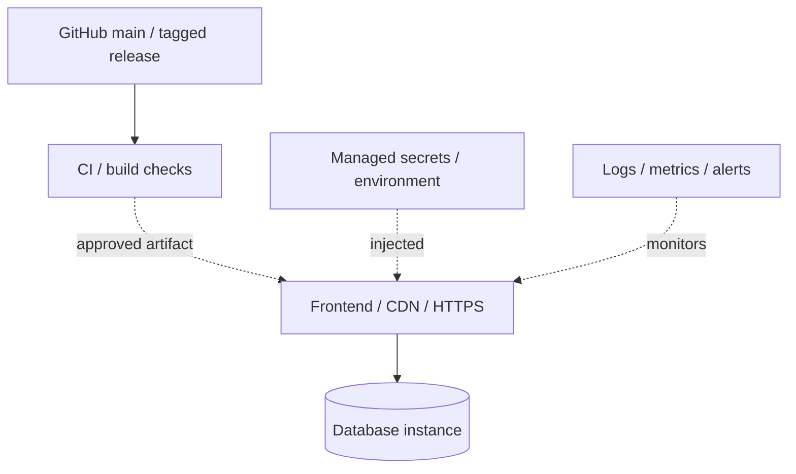

# Varada reusable app skeleton - Architecture, Deployment, ER, Database, Migration & KT Guide
> **Code snapshot:** 2026-11-09, `main` branch of [varadatechworks/app-skeleton](https://github.com/varadatechworks/app-skeleton). **Repository-derived reference**; cloud environment and deployed DB must be verified separately.
**Library gate:** no production deployment or persisted schema is implied by these templates.
## 1. System context and component architecture
**Stack observed / documented:** Node.js modular library; PostgreSQL/D1 example DDL. Source has no verified web app, no verified mobile app and no verified backend source.


**Cross-cutting contracts:** server-validated inputs; least-privilege RBAC; concurrency/idempotency; customer vs admin isolation; audit IDs; non-secret config; appropriate geo evidence and billing snapshots where applicable.

## 2. Deployment diagram (logical reference, not production verification)

**Complete for each environment:** cloud project/region, DNS and custom domain, static/web deployment, API container/function, environment names, database identity, secret manager, backup owner, health check, rollback release, CI status and contact matrix. Diagram does **not** establish a running deployment.

## 3. ER diagram - PostgreSQL template subset (other dialects separately versioned)
The ER uses `CREATE TABLE` and declared `REFERENCES` found in **2 selected baseline file(s)**, not every subsequent migration. It is not a complete physical ER; export the current database catalog for authoritative tables, columns and foreign keys.

```mermaid
erDiagram
    APP_USERS {
        TEXT id PK
        TEXT tenant_id FK
        TEXT email
        TEXT mobile
        TEXT display_name
        TEXT status
        TEXT locale
        TIMESTAMPTZ created_at
        TIMESTAMPTZ updated_at
    }
    APPROVAL_REQUESTS {
        TEXT id PK
        TEXT tenant_id FK
        TEXT entity_type
        TEXT entity_id
        TEXT maker_id FK
        TEXT reviewer_id FK
        TEXT status
        INTEGER version
        JSONB payload
    }
    CMS_ITEMS {
        TEXT id PK
        TEXT tenant_id FK
        TEXT author_id FK
        TEXT category
        TEXT locale
        TEXT title
        TEXT status
        INTEGER version
        JSONB payload
    }
    GEOGRAPHY_NODES {
        TEXT id PK
        TEXT tenant_id FK
        TEXT parent_id
        TEXT level
        TEXT name
        BOOLEAN active
    }
    NOTIFICATION_OUTBOX {
        TEXT id PK
        TEXT tenant_id FK
        TEXT user_id FK
        TEXT channel
        JSONB payload
        TEXT status
        INTEGER attempts
        TIMESTAMPTZ next_attempt_at
        TEXT provider_ref
    }
    NOTIFICATION_PREFERENCES {
        TEXT tenant_id PK
        TEXT user_id PK
        TEXT channel PK
        BOOLEAN consent
        BOOLEAN enabled
    }
    PAYMENT_INTENTS {
        TEXT id PK
        TEXT tenant_id FK
        TEXT provider
        TEXT provider_order_id
        TEXT order_id
        BIGINT amount_minor
        CHAR currency
        TEXT status
        JSONB quote_snapshot
    }
    PAYMENT_LEDGER {
        TEXT id PK
        TEXT tenant_id FK
        TEXT transaction_id
        TEXT refund_id
        TEXT entry_type
        BIGINT amount_minor
        CHAR currency
        TEXT external_event_key
        TIMESTAMPTZ recorded_at
    }
    PAYMENT_REFUNDS {
        TEXT id PK
        TEXT tenant_id FK
        TEXT transaction_id
        TEXT provider_refund_id
        TEXT client_idempotency_key
        BIGINT requested_minor
        BIGINT fee_deduction_minor
        BIGINT provider_refund_minor
        TEXT reason
    }
    PAYMENT_SETTLEMENTS {
        TEXT id PK
        TEXT tenant_id FK
        TEXT provider
        TEXT settlement_ref
        TEXT transaction_id
        BIGINT net_minor
        BIGINT platform_fee_minor
        BIGINT processing_fee_minor
        BIGINT partner_payout_minor
    }
    PAYMENT_TRANSACTIONS {
        TEXT id PK
        TEXT tenant_id FK
        TEXT intent_id
        TEXT provider
        TEXT provider_payment_id
        BIGINT amount_minor
        CHAR currency
        TEXT status
        TIMESTAMPTZ occurred_at
    }
    ROLE_PERMISSIONS {
        TEXT tenant_id PK
        TEXT role_id PK
        TEXT feature_code PK
        TEXT action PK
    }
    ROLES {
        TEXT id PK
        TEXT tenant_id FK
        TEXT code
        TEXT name
        BOOLEAN active
    }
    SURVEY_FORM_VERSIONS {
        TEXT form_id PK
        TEXT tenant_id FK
        INTEGER version PK
        JSONB definition
        TIMESTAMPTZ created_at
    }
    SURVEY_FORMS {
        TEXT id PK
        TEXT tenant_id FK
        TEXT title
        TEXT status
        INTEGER current_version
        TIMESTAMPTZ opens_at
        TIMESTAMPTZ closes_at
        BOOLEAN require_location
        TEXT submission_mode
    }
    SURVEY_SUBMISSIONS {
        TEXT id PK
        TEXT tenant_id FK
        TEXT form_id FK
        INTEGER form_version
        TEXT actor_id FK
        TEXT geography_id FK
        JSONB answers
        DOUBLE latitude
        DOUBLE longitude
    }
    SURVEY_TARGETS {
        TEXT id PK
        TEXT tenant_id FK
        TEXT form_id FK
        TEXT target_type
        TEXT target_id
    }
    TENANTS {
        TEXT id PK
        TEXT name
        TEXT deployment_mode
        BOOLEAN active
        TIMESTAMPTZ created_at
    }
    USER_GEOGRAPHY_SCOPES {
        TEXT id PK
        TEXT tenant_id FK
        TEXT user_id
        TEXT geography_id
        TEXT function_code
        BOOLEAN active
    }
    USER_ROLE_ASSIGNMENTS {
        TEXT id PK
        TEXT tenant_id FK
        TEXT user_id
        TEXT role_id
        TEXT function_code
        BOOLEAN active
        TIMESTAMPTZ created_at
    }
    TENANTS ||--o{ APP_USERS : tenant_id
    TENANTS ||--o{ ROLES : tenant_id
    TENANTS ||--o{ ROLE_PERMISSIONS : tenant_id
    ROLES ||--o{ ROLE_PERMISSIONS : tenant_id
    TENANTS ||--o{ USER_ROLE_ASSIGNMENTS : tenant_id
    APP_USERS ||--o{ USER_ROLE_ASSIGNMENTS : tenant_id
    ROLES ||--o{ USER_ROLE_ASSIGNMENTS : tenant_id
    TENANTS ||--o{ GEOGRAPHY_NODES : tenant_id
    TENANTS ||--o{ USER_GEOGRAPHY_SCOPES : tenant_id
    APP_USERS ||--o{ USER_GEOGRAPHY_SCOPES : tenant_id
    GEOGRAPHY_NODES ||--o{ USER_GEOGRAPHY_SCOPES : tenant_id
    TENANTS ||--o{ APPROVAL_REQUESTS : tenant_id
    APP_USERS ||--o{ APPROVAL_REQUESTS : maker_id
    TENANTS ||--o{ NOTIFICATION_PREFERENCES : tenant_id
    APP_USERS ||--o{ NOTIFICATION_PREFERENCES : user_id
    TENANTS ||--o{ NOTIFICATION_OUTBOX : tenant_id
    APP_USERS ||--o{ NOTIFICATION_OUTBOX : user_id
    TENANTS ||--o{ SURVEY_FORMS : tenant_id
    SURVEY_FORMS ||--o{ SURVEY_FORM_VERSIONS : form_id
    TENANTS ||--o{ SURVEY_FORM_VERSIONS : tenant_id
    TENANTS ||--o{ SURVEY_TARGETS : tenant_id
    SURVEY_FORMS ||--o{ SURVEY_TARGETS : form_id
    TENANTS ||--o{ SURVEY_SUBMISSIONS : tenant_id
    SURVEY_FORMS ||--o{ SURVEY_SUBMISSIONS : form_id
    APP_USERS ||--o{ SURVEY_SUBMISSIONS : actor_id
    GEOGRAPHY_NODES ||--o{ SURVEY_SUBMISSIONS : geography_id
    TENANTS ||--o{ CMS_ITEMS : tenant_id
    APP_USERS ||--o{ CMS_ITEMS : author_id
    TENANTS ||--o{ PAYMENT_INTENTS : tenant_id
    TENANTS ||--o{ PAYMENT_TRANSACTIONS : tenant_id
    PAYMENT_INTENTS ||--o{ PAYMENT_TRANSACTIONS : tenant_id
    TENANTS ||--o{ PAYMENT_REFUNDS : tenant_id
    PAYMENT_TRANSACTIONS ||--o{ PAYMENT_REFUNDS : tenant_id
    TENANTS ||--o{ PAYMENT_LEDGER : tenant_id
    PAYMENT_TRANSACTIONS ||--o{ PAYMENT_LEDGER : tenant_id
    PAYMENT_REFUNDS ||--o{ PAYMENT_LEDGER : tenant_id
    TENANTS ||--o{ PAYMENT_SETTLEMENTS : tenant_id
    PAYMENT_TRANSACTIONS ||--o{ PAYMENT_SETTLEMENTS : tenant_id
```



## 4. Database schema and migration registry
**DDL source files detected:** 4 across PostgreSQL and D1 alternatives. **The ER above represents PostgreSQL template DDL only**; the two database dialects must not be counted or applied as a merged physical schema. The full and exact schema is defined by the ordered source SQL and later ALTERs, plus the deployed migration history; this table-name view is intentionally limited to inspected baseline files.

Previously sampled template table names (one dialect, not a deployed database): `tenants`, `app_users`, `roles`, `role_permissions`, `user_role_assignments`, `geography_nodes`, `user_geography_scopes`, `approval_requests`, `notification_templates`, `notification_preferences`, `notification_outbox`, `survey_forms`, `survey_form_versions`, `survey_targets`, `survey_submissions`, `cms_items`, `report_definitions`, `audit_events`, `feature_flags`, `app_releases`, `commerce_rules`, `payment_webhook_events`.

**Versioned SQL / schema paths:**
- [`sql/d1/0001_core.sql`](../../sql/d1/0001_core.sql)
- [`sql/d1/0002_payments.sql`](../../sql/d1/0002_payments.sql)
- [`sql/postgres/0001_core.sql`](../../sql/postgres/0001_core.sql)
- [`sql/postgres/0002_payments.sql`](../../sql/postgres/0002_payments.sql)

These are **multiple alternative database templates**, not a single cumulative migration series.


For a verified PostgreSQL schema snapshot: `pg_dump --schema-only --no-owner --no-privileges "$DATABASE_URL" > schema-only.sql`. For SQLite/D1, inspect `sqlite_master` and `PRAGMA table_info` in the correct environment. Never upload production PII or credentials to docs.

## 5. Safe migration script and procedures
**Repository-native migration:** No live migration: DDL is templates applied by consumer projects only. Copy/adapt this guarded operator wrapper into the deployment runbook; it performs **no migration by default**.

```bash
#!/usr/bin/env bash
set -euo pipefail
if [[ "${1:-plan}" != "apply" ]]; then
  echo 'PLAN ONLY: verify target branch/SHA, migration history, pending DDL and permissions'
  echo 'Back up, restore-test, dry-run in staging and record release/backup references.'
  exit 0
fi
[[ "${CONFIRM_DB_MIGRATION:-}" == "BACKUP_VERIFIED" ]] || exit 3
: "${BACKUP_REFERENCE:?Verified backup/snapshot reference required}"
: "${MIGRATION_APPLY_CMD:?Provide the reviewed repository-native migration command}"
bash -lc "$MIGRATION_APPLY_CMD"
echo 'Verify migration tracking table, API health, smoke tests, reconciliation and audit.'
```
**Process:** (1) compare applied versions/checksums; (2) review forward/backward compatibility; (3) backup + actual restoration rehearsal; (4) staging migration/test; (5) review/approve; (6) production apply once; (7) verify health, business smoke and data; (8) record release; (9) recover using tested restore or forward-fix, never blindly undo destructive SQL. Production seeding is prohibited by default.

## 6. Build, release and deployment KT
- Check out the exact release SHA, supported runtime from `package.json` / `pom.xml` and documented local dependencies.
- Run repository tests/build/coverage as configured, inspect CI workflow failures, artifacts, lint/typecheck and vulnerability scans.
- Configure HTTPS, tenant/role/OTP modes, CORS and sessions; keep third-party secrets and payment credentials out of GitHub.
- Validate database connectivity, migration record, app health, cron/background jobs, callback signature verification, logs and alert routes.
- For web/mobile releases verify required version controls, app signing, staging-only toggles and rollback compatibility when present.

## 7. Support, maintenance and incident runbook
**Daily:** health/error rates, auth errors, queue/jobs, webhook exceptions, failed payment/invoice notifications and CI deploy status. **Weekly:** DB backup checks, restore sample, retention, storage growth, payment/reconciliation where relevant, access review. **Monthly:** dependency patching, cert renewals, DR drill, audit review and architecture drift.  
**Incident:** establish scope/last-good SHA; protect logs; disable unsafe writes; compare current vs expected config; use tested rollback/restore; verify with smoke tests; record RCA and corrective test cases.

## 8. KT and customer UAT demo script
**Show:** Select modules -> generate sample project -> validate adapter integration.
| Minutes | What to demonstrate |
|---|---|
| 0-10 | Product scope, stakeholders, roles, current maturity |
| 10-25 | Main happy path + real error/success messages |
| 25-40 | Architecture, data flows, DB, RBAC and integrations |
| 40-50 | Local build, CI/deploy, migration and rollback |
| 50-60 | Backups, monitoring, admin operations, UAT gaps and contacts |

**Negative tests:** bad credentials, expired session, forbidden role, bad input, duplicate submission, concurrent operation/stock conflict, offline/timeouts, provider failures, duplicate webhook if used, failed refund, DB loss, location missing (where relevant), invalid migration and tenant leak. Demonstrate only sandbox transactions unless deployment approval is recorded.

## 9. Handover checklist and known evidence gaps
- [ ] Production/staging service URLs, domains, hosting region, owner and runtime version documented
- [ ] Secrets access handed over via vault (NO values committed)
- [ ] Build and CI evidence, test report/coverage and open defects acknowledged
- [ ] Current database schema-only export and ER reconciled to deployed SHA
- [ ] Migration history, checksum changes and backup/restore evidence signed
- [ ] Health, logs, monitoring thresholds and escalation contact operational
- [ ] Application walkthrough, operational SOP and security/negative UAT approved
- [ ] Release steps, rollback/forward-fix plan and next maintenance window owned

**Other source documentation:**
- [`docs/ARCHITECTURE.md`](../../docs/ARCHITECTURE.md)
- CI: [`.github/workflows/manual-quality.yml`](../../.github/workflows/manual-quality.yml)

*This guide is a source-derived starting point for KT. Do not claim that source presence means production deployment, a passing CI run or an accurate live-schema export.*
