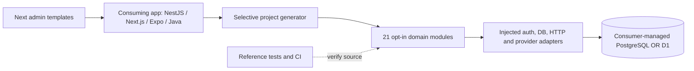

# App Skeleton — code-recovered module architecture and integration handover

> Based on [`varadatechworks/app-skeleton` `main`](https://github.com/varadatechworks/app-skeleton/tree/main) on 10 Nov 2026. This is **a library and generator**, not an already deployed web, API or mobile product.

## Deployment and integration context

The caller supplies actual auth verification, data access, secrets, cloud hosting and notification/payment provider configuration. Copying a module, generating a project or running library unit tests does not establish application security or integration readiness.

## All 21 catalogued modules
| Module | Group | Dependencies | Library entrypoint |
|---|---|---|---|
| `identity` | foundation | tenant | [`modules/identity/index.mjs`](https://github.com/varadatechworks/app-skeleton/blob/main/modules/identity/index.mjs) |
| `authorization` | foundation | geo, tenant | [`modules/authorization/index.mjs`](https://github.com/varadatechworks/app-skeleton/blob/main/modules/authorization/index.mjs) |
| `tenant` | foundation | none | [`modules/tenant/index.mjs`](https://github.com/varadatechworks/app-skeleton/blob/main/modules/tenant/index.mjs) |
| `database` | foundation | none | [`modules/database/index.mjs`](https://github.com/varadatechworks/app-skeleton/blob/main/modules/database/index.mjs) |
| `geo` | field | none | [`modules/geo/index.mjs`](https://github.com/varadatechworks/app-skeleton/blob/main/modules/geo/index.mjs) |
| `survey` | field | geo | [`modules/survey/index.mjs`](https://github.com/varadatechworks/app-skeleton/blob/main/modules/survey/index.mjs) |
| `notifications` | engagement | none | [`modules/notifications/index.mjs`](https://github.com/varadatechworks/app-skeleton/blob/main/modules/notifications/index.mjs) |
| `approvals` | governance | none | [`modules/approvals/index.mjs`](https://github.com/varadatechworks/app-skeleton/blob/main/modules/approvals/index.mjs) |
| `cms` | engagement | approvals | [`modules/cms/index.mjs`](https://github.com/varadatechworks/app-skeleton/blob/main/modules/cms/index.mjs) |
| `reporting` | operations | none | [`modules/reporting/index.mjs`](https://github.com/varadatechworks/app-skeleton/blob/main/modules/reporting/index.mjs) |
| `admin` | operations | none | [`modules/admin/index.mjs`](https://github.com/varadatechworks/app-skeleton/blob/main/modules/admin/index.mjs) |
| `audit` | governance | geo | [`modules/audit/index.mjs`](https://github.com/varadatechworks/app-skeleton/blob/main/modules/audit/index.mjs) |
| `billing` | commerce | none | [`modules/billing/index.mjs`](https://github.com/varadatechworks/app-skeleton/blob/main/modules/billing/index.mjs) |
| `workflow` | operations | none | [`modules/workflow/index.mjs`](https://github.com/varadatechworks/app-skeleton/blob/main/modules/workflow/index.mjs) |
| `feature-flags` | operations | none | [`modules/feature-flags/index.mjs`](https://github.com/varadatechworks/app-skeleton/blob/main/modules/feature-flags/index.mjs) |
| `storage` | foundation | none | [`modules/storage/index.mjs`](https://github.com/varadatechworks/app-skeleton/blob/main/modules/storage/index.mjs) |
| `i18n` | engagement | none | [`modules/i18n/index.mjs`](https://github.com/varadatechworks/app-skeleton/blob/main/modules/i18n/index.mjs) |
| `import-export` | operations | reporting | [`modules/import-export/index.mjs`](https://github.com/varadatechworks/app-skeleton/blob/main/modules/import-export/index.mjs) |
| `observability` | operations | none | [`modules/observability/index.mjs`](https://github.com/varadatechworks/app-skeleton/blob/main/modules/observability/index.mjs) |
| `app-management` | operations | none | [`modules/app-management/index.mjs`](https://github.com/varadatechworks/app-skeleton/blob/main/modules/app-management/index.mjs) |
| `payments` | commerce | none | [`modules/payments/index.mjs`](https://github.com/varadatechworks/app-skeleton/blob/main/modules/payments/index.mjs) |

## Available adapters (4 catalog entries)
| Adapter | Dependency contract | Catalog |
|---|---|---|
| `postgres` | tenant, database | [`catalog/adapters.json`](https://github.com/varadatechworks/app-skeleton/blob/main/catalog/adapters.json) |
| `d1` | tenant, database | [`catalog/adapters.json`](https://github.com/varadatechworks/app-skeleton/blob/main/catalog/adapters.json) |
| `node-http` | identity, tenant | [`catalog/adapters.json`](https://github.com/varadatechworks/app-skeleton/blob/main/catalog/adapters.json) |
| `java` | none | [`catalog/adapters.json`](https://github.com/varadatechworks/app-skeleton/blob/main/catalog/adapters.json) |
**Adapter implementations in source**
- [`adapters/d1/index.mjs`](https://github.com/varadatechworks/app-skeleton/blob/main/adapters/d1/index.mjs)
- [`adapters/expo/index.mjs`](https://github.com/varadatechworks/app-skeleton/blob/main/adapters/expo/index.mjs)
- [`adapters/expo/secure-session.mjs`](https://github.com/varadatechworks/app-skeleton/blob/main/adapters/expo/secure-session.mjs)
- [`adapters/nestjs/index.mjs`](https://github.com/varadatechworks/app-skeleton/blob/main/adapters/nestjs/index.mjs)
- [`adapters/nextjs/index.mjs`](https://github.com/varadatechworks/app-skeleton/blob/main/adapters/nextjs/index.mjs)
- [`adapters/node-http/index.mjs`](https://github.com/varadatechworks/app-skeleton/blob/main/adapters/node-http/index.mjs)
- [`adapters/postgres/idempotency.mjs`](https://github.com/varadatechworks/app-skeleton/blob/main/adapters/postgres/idempotency.mjs)
- [`adapters/postgres/index.mjs`](https://github.com/varadatechworks/app-skeleton/blob/main/adapters/postgres/index.mjs)
- [`adapters/postgres/outbox.mjs`](https://github.com/varadatechworks/app-skeleton/blob/main/adapters/postgres/outbox.mjs)
- [`adapters/providers/http.mjs`](https://github.com/varadatechworks/app-skeleton/blob/main/adapters/providers/http.mjs)
- [`adapters/providers/notifications.mjs`](https://github.com/varadatechworks/app-skeleton/blob/main/adapters/providers/notifications.mjs)
- [`adapters/providers/razorpay.mjs`](https://github.com/varadatechworks/app-skeleton/blob/main/adapters/providers/razorpay.mjs)

## Admin UI template files (9)
- [`templates/next-admin/AdminSidebar.tsx`](https://github.com/varadatechworks/app-skeleton/blob/main/templates/next-admin/AdminSidebar.tsx)
- [`templates/next-admin/CmsEditor.tsx`](https://github.com/varadatechworks/app-skeleton/blob/main/templates/next-admin/CmsEditor.tsx)
- [`templates/next-admin/GeographyAssignments.tsx`](https://github.com/varadatechworks/app-skeleton/blob/main/templates/next-admin/GeographyAssignments.tsx)
- [`templates/next-admin/NotificationComposer.tsx`](https://github.com/varadatechworks/app-skeleton/blob/main/templates/next-admin/NotificationComposer.tsx)
- [`templates/next-admin/OperationsDashboard.tsx`](https://github.com/varadatechworks/app-skeleton/blob/main/templates/next-admin/OperationsDashboard.tsx)
- [`templates/next-admin/ReportsPanel.tsx`](https://github.com/varadatechworks/app-skeleton/blob/main/templates/next-admin/ReportsPanel.tsx)
- [`templates/next-admin/RoleMatrix.tsx`](https://github.com/varadatechworks/app-skeleton/blob/main/templates/next-admin/RoleMatrix.tsx)
- [`templates/next-admin/SurveyBuilder.tsx`](https://github.com/varadatechworks/app-skeleton/blob/main/templates/next-admin/SurveyBuilder.tsx)
- [`templates/next-admin/UsersPage.tsx`](https://github.com/varadatechworks/app-skeleton/blob/main/templates/next-admin/UsersPage.tsx)

## Database dialects and ordering
- [`sql/d1/0001_core.sql`](https://github.com/varadatechworks/app-skeleton/blob/main/sql/d1/0001_core.sql)
- [`sql/d1/0002_payments.sql`](https://github.com/varadatechworks/app-skeleton/blob/main/sql/d1/0002_payments.sql)
- [`sql/postgres/0001_core.sql`](https://github.com/varadatechworks/app-skeleton/blob/main/sql/postgres/0001_core.sql)
- [`sql/postgres/0002_payments.sql`](https://github.com/varadatechworks/app-skeleton/blob/main/sql/postgres/0002_payments.sql)
- [`sql/postgres/0003_idempotency.sql`](https://github.com/varadatechworks/app-skeleton/blob/main/sql/postgres/0003_idempotency.sql)
- [`sql/postgres/0004_outbox_leases.sql`](https://github.com/varadatechworks/app-skeleton/blob/main/sql/postgres/0004_outbox_leases.sql)

- PostgreSQL `0001_core`, `0002_payments`, **`0003_idempotency`**, **`0004_outbox_leases`** are present in `main`. The last two were absent from the previous static schema catalogue; this dossier reflects the newer source.
- D1 has its own `0001_core`/`0002_payments` alternative. **Do not run both database variants against one project.**
- PostgreSQL idempotency adds tenant RLS and uniqueness. The outbox lease migration adds bounded workers and `FOR UPDATE SKIP LOCKED`-based dispatch in the adapter implementation. Verify grants/RLS with an actual **non-owner** database role.
- See [existing reference schema/ER](SCHEMA_INDEX.md) and migration SQL. A generated app owns real incremental migrations, reconciliation, backup/restore and privacy retention.

## Build, tests, runtime
Node.js >=20, no install-time production runtime dependencies for reference core; [root scripts](https://github.com/varadatechworks/app-skeleton/blob/main/package.json): `npm test`, `npm run coverage`, `npm run modules`, and `npm run new`. Exact CLI: `node tools/create-app.mjs --list` or `node tools/create-app.mjs --project sample --modules identity,authorization,notifications --db postgres --adapters postgres,node-http --ui next-admin --out /tmp`.

**Test files present:** 32. [`tests/admin.test.mjs`](https://github.com/varadatechworks/app-skeleton/blob/main/tests/admin.test.mjs) · [`tests/app-management.test.mjs`](https://github.com/varadatechworks/app-skeleton/blob/main/tests/app-management.test.mjs) · [`tests/approvals.test.mjs`](https://github.com/varadatechworks/app-skeleton/blob/main/tests/approvals.test.mjs) · [`tests/audit.test.mjs`](https://github.com/varadatechworks/app-skeleton/blob/main/tests/audit.test.mjs) · [`tests/authorization.test.mjs`](https://github.com/varadatechworks/app-skeleton/blob/main/tests/authorization.test.mjs) · [`tests/billing.test.mjs`](https://github.com/varadatechworks/app-skeleton/blob/main/tests/billing.test.mjs) · [`tests/cms.test.mjs`](https://github.com/varadatechworks/app-skeleton/blob/main/tests/cms.test.mjs) · [`tests/d1-adapter.test.mjs`](https://github.com/varadatechworks/app-skeleton/blob/main/tests/d1-adapter.test.mjs) · [`tests/database.test.mjs`](https://github.com/varadatechworks/app-skeleton/blob/main/tests/database.test.mjs) · [`tests/expo-session.test.mjs`](https://github.com/varadatechworks/app-skeleton/blob/main/tests/expo-session.test.mjs) · [`tests/feature-flags.test.mjs`](https://github.com/varadatechworks/app-skeleton/blob/main/tests/feature-flags.test.mjs) · [`tests/generator.test.mjs`](https://github.com/varadatechworks/app-skeleton/blob/main/tests/generator.test.mjs) · [`tests/geo.test.mjs`](https://github.com/varadatechworks/app-skeleton/blob/main/tests/geo.test.mjs) · [`tests/i18n.test.mjs`](https://github.com/varadatechworks/app-skeleton/blob/main/tests/i18n.test.mjs) · [`tests/identity.test.mjs`](https://github.com/varadatechworks/app-skeleton/blob/main/tests/identity.test.mjs) · [`tests/import-export.test.mjs`](https://github.com/varadatechworks/app-skeleton/blob/main/tests/import-export.test.mjs) · [`tests/integration-adapters.test.mjs`](https://github.com/varadatechworks/app-skeleton/blob/main/tests/integration-adapters.test.mjs) · [`tests/node-http-adapter.test.mjs`](https://github.com/varadatechworks/app-skeleton/blob/main/tests/node-http-adapter.test.mjs) · [`tests/notifications.test.mjs`](https://github.com/varadatechworks/app-skeleton/blob/main/tests/notifications.test.mjs) · [`tests/observability.test.mjs`](https://github.com/varadatechworks/app-skeleton/blob/main/tests/observability.test.mjs) · [`tests/outbox-worker.test.mjs`](https://github.com/varadatechworks/app-skeleton/blob/main/tests/outbox-worker.test.mjs) · [`tests/payment-lifecycle.test.mjs`](https://github.com/varadatechworks/app-skeleton/blob/main/tests/payment-lifecycle.test.mjs) · [`tests/payments.test.mjs`](https://github.com/varadatechworks/app-skeleton/blob/main/tests/payments.test.mjs) · [`tests/postgres-adapter.test.mjs`](https://github.com/varadatechworks/app-skeleton/blob/main/tests/postgres-adapter.test.mjs) · [`tests/postgres-live.test.mjs`](https://github.com/varadatechworks/app-skeleton/blob/main/tests/postgres-live.test.mjs) · [`tests/reporting.test.mjs`](https://github.com/varadatechworks/app-skeleton/blob/main/tests/reporting.test.mjs) · [`tests/role-service.test.mjs`](https://github.com/varadatechworks/app-skeleton/blob/main/tests/role-service.test.mjs) · [`tests/storage.test.mjs`](https://github.com/varadatechworks/app-skeleton/blob/main/tests/storage.test.mjs) · [`tests/survey.test.mjs`](https://github.com/varadatechworks/app-skeleton/blob/main/tests/survey.test.mjs) · [`tests/tenant.test.mjs`](https://github.com/varadatechworks/app-skeleton/blob/main/tests/tenant.test.mjs) · [`tests/user-service.test.mjs`](https://github.com/varadatechworks/app-skeleton/blob/main/tests/user-service.test.mjs) · [`tests/workflow.test.mjs`](https://github.com/varadatechworks/app-skeleton/blob/main/tests/workflow.test.mjs)

**Build and CI entrypoints**
- [`.github/workflows/ci.yml`](https://github.com/varadatechworks/app-skeleton/blob/main/.github/workflows/ci.yml)
- [`.github/workflows/manual-quality.yml`](https://github.com/varadatechworks/app-skeleton/blob/main/.github/workflows/manual-quality.yml)
- [`tools/create-app.mjs`](https://github.com/varadatechworks/app-skeleton/blob/main/tools/create-app.mjs)

## Consumer architecture and security decisions to make
- Session tokens must be validated **before** a guard receives actor/tenant claims; front-end menus are not a security boundary.
- Use strict per-tenant query/RLS policy, transaction-bound idempotency and exact provider webhook signatures + replay deduplication.
- Outbox is at-least-once; design provider idempotency, retry/dead-letter metrics and audit.
- Next.js, NestJS, Expo adapters require real framework integration, network/offline E2E, migrations and access-control UAT in each consuming application.
- The Java adapter is a **JDK-only contract reference** for Spring Boot consumers, not automatically shared runnable Java services.
- Review app-level hosting (customer-managed, single-tenant, SaaS) separately from module entitlement; do not claim tenant isolation is certified from library tests.

## KT demo
Generate a minimal app with selected modules; show dependency selection and module outputs; inspect non-secret environment files, tenancy and RBAC guards, PostgreSQL migration ordering, payment/webhook idempotency, durable notifications and unit tests. Validate a sample app with real disposable Postgres and fake providers before signoff. Record downstream consumer owners and open adapter limitations.

**Existing controls:** [integration contract](../../docs/INTEGRATION.md), [architecture](../../docs/ARCHITECTURE.md), [release/UAT gates](../../docs/RELEASE_UAT.md).
