# App Skeleton - Alternative PostgreSQL and D1 Schema Templates

> **This repository is a reusable module library, not a deployed application.** DDL here is an example baseline for generated projects, not evidence of any live database or migration success. Source snapshot: 2026-11-09.

## PostgreSQL example
SQL: [core](../../sql/postgres/0001_core.sql) · [payments](../../sql/postgres/0002_payments.sql)

```mermaid
erDiagram
    TENANTS {
        TEXT id
        TEXT name
        TEXT deployment_mode
        BOOLEAN active
        TIMESTAMP created_at
    }
    APP_USERS {
        TEXT id
        TEXT tenant_id
        TEXT email
        TEXT mobile
        TEXT display_name
        TEXT status
    }
    ROLES {
        TEXT id
        TEXT tenant_id
        TEXT code
        TEXT name
        BOOLEAN active
    }
    ROLE_PERMISSIONS {
        TEXT tenant_id
        TEXT role_id
        TEXT feature_code
        TEXT action
    }
    USER_ROLE_ASSIGNMENTS {
        TEXT id
        TEXT tenant_id
        TEXT user_id
        TEXT role_id
        TEXT function_code
        BOOLEAN active
    }
    GEOGRAPHY_NODES {
        TEXT id
        TEXT tenant_id
        TEXT parent_id
        TEXT level
        TEXT name
        BOOLEAN active
    }
    USER_GEOGRAPHY_SCOPES {
        TEXT id
        TEXT tenant_id
        TEXT user_id
        TEXT geography_id
        TEXT function_code
        BOOLEAN active
    }
    APPROVAL_REQUESTS {
        TEXT id
        TEXT tenant_id
        TEXT entity_type
        TEXT entity_id
        TEXT maker_id
        TEXT reviewer_id
    }
    NOTIFICATION_TEMPLATES {
        TEXT id
        TEXT tenant_id
        TEXT code
        TEXT channel
        TEXT locale
        TEXT body
    }
    NOTIFICATION_PREFERENCES {
        TEXT tenant_id
        TEXT user_id
        TEXT channel
        BOOLEAN consent
        BOOLEAN enabled
    }
    NOTIFICATION_OUTBOX {
        TEXT id
        TEXT tenant_id
        TEXT user_id
        TEXT channel
        JSONB payload
        TEXT status
    }
    SURVEY_FORMS {
        TEXT id
        TEXT tenant_id
        TEXT title
        TEXT status
        INTEGER current_version
        TIMESTAMP opens_at
    }
    SURVEY_FORM_VERSIONS {
        TEXT form_id
        TEXT tenant_id
        INTEGER version
        JSONB definition
        TIMESTAMP created_at
    }
    SURVEY_TARGETS {
        TEXT id
        TEXT tenant_id
        TEXT form_id
        TEXT target_type
        TEXT target_id
    }
    SURVEY_SUBMISSIONS {
        TEXT id
        TEXT tenant_id
        TEXT form_id
        INTEGER form_version
        TEXT actor_id
        TEXT geography_id
    }
    CMS_ITEMS {
        TEXT id
        TEXT tenant_id
        TEXT author_id
        TEXT category
        TEXT locale
        TEXT title
    }
    REPORT_DEFINITIONS {
        TEXT id
        TEXT tenant_id
        TEXT code
        TEXT name
        JSONB definition
        BOOLEAN active
    }
    AUDIT_EVENTS {
        TEXT id
        TEXT tenant_id
        TEXT actor_id
        TEXT action
        TEXT resource
        TEXT resource_id
    }
    FEATURE_FLAGS {
        TEXT tenant_id
        TEXT code
        BOOLEAN enabled
    }
    APP_RELEASES {
        TEXT id
        TEXT tenant_id
        TEXT platform
        TEXT version_name
        INTEGER version_code
        TEXT url
    }
    COMMERCE_RULES {
        TEXT id
        TEXT tenant_id
        TEXT kind
        TEXT scope
        TEXT target_id
        JSONB config
    }
    PAYMENT_WEBHOOK_EVENTS {
        TEXT tenant_id
        TEXT provider
        TEXT event_id
        TEXT status
        TIMESTAMP received_at
    }
    PAYMENT_INTENTS {
        TEXT id
        TEXT tenant_id
        TEXT provider
        TEXT provider_order_id
        TEXT order_id
        BIGINT amount_minor
    }
    PAYMENT_TRANSACTIONS {
        TEXT id
        TEXT tenant_id
        TEXT intent_id
        TEXT provider
        TEXT provider_payment_id
        BIGINT amount_minor
    }
    PAYMENT_REFUNDS {
        TEXT id
        TEXT tenant_id
        TEXT transaction_id
        TEXT provider_refund_id
        TEXT client_idempotency_key
        BIGINT requested_minor
    }
    PAYMENT_LEDGER {
        TEXT id
        TEXT tenant_id
        TEXT transaction_id
        TEXT refund_id
        TEXT entry_type
        BIGINT amount_minor
    }
    PAYMENT_SETTLEMENTS {
        TEXT id
        TEXT tenant_id
        TEXT provider
        TEXT settlement_ref
        TEXT transaction_id
        BIGINT net_minor
    }
```

### PostgreSQL example table dictionary
#### `tenants` — [SQL](../../sql/postgres/0001_core.sql)
| Column | Type |
|---|---|
| `id` | `TEXT` |
| `name` | `TEXT` |
| `deployment_mode` | `TEXT` |
| `active` | `BOOLEAN` |
| `created_at` | `TIMESTAMP` |

#### `app_users` — [SQL](../../sql/postgres/0001_core.sql)
| Column | Type |
|---|---|
| `id` | `TEXT` |
| `tenant_id` | `TEXT` |
| `email` | `TEXT` |
| `mobile` | `TEXT` |
| `display_name` | `TEXT` |
| `status` | `TEXT` |
| `locale` | `TEXT` |
| `created_at` | `TIMESTAMP` |
| `updated_at` | `TIMESTAMP` |

#### `roles` — [SQL](../../sql/postgres/0001_core.sql)
| Column | Type |
|---|---|
| `id` | `TEXT` |
| `tenant_id` | `TEXT` |
| `code` | `TEXT` |
| `name` | `TEXT` |
| `active` | `BOOLEAN` |

#### `role_permissions` — [SQL](../../sql/postgres/0001_core.sql)
| Column | Type |
|---|---|
| `tenant_id` | `TEXT` |
| `role_id` | `TEXT` |
| `feature_code` | `TEXT` |
| `action` | `TEXT` |

#### `user_role_assignments` — [SQL](../../sql/postgres/0001_core.sql)
| Column | Type |
|---|---|
| `id` | `TEXT` |
| `tenant_id` | `TEXT` |
| `user_id` | `TEXT` |
| `role_id` | `TEXT` |
| `function_code` | `TEXT` |
| `active` | `BOOLEAN` |
| `created_at` | `TIMESTAMP` |

#### `geography_nodes` — [SQL](../../sql/postgres/0001_core.sql)
| Column | Type |
|---|---|
| `id` | `TEXT` |
| `tenant_id` | `TEXT` |
| `parent_id` | `TEXT` |
| `level` | `TEXT` |
| `name` | `TEXT` |
| `active` | `BOOLEAN` |

#### `user_geography_scopes` — [SQL](../../sql/postgres/0001_core.sql)
| Column | Type |
|---|---|
| `id` | `TEXT` |
| `tenant_id` | `TEXT` |
| `user_id` | `TEXT` |
| `geography_id` | `TEXT` |
| `function_code` | `TEXT` |
| `active` | `BOOLEAN` |

#### `approval_requests` — [SQL](../../sql/postgres/0001_core.sql)
| Column | Type |
|---|---|
| `id` | `TEXT` |
| `tenant_id` | `TEXT` |
| `entity_type` | `TEXT` |
| `entity_id` | `TEXT` |
| `maker_id` | `TEXT` |
| `reviewer_id` | `TEXT` |
| `status` | `TEXT` |
| `version` | `INTEGER` |
| `payload` | `JSONB` |
| `submitted_at` | `TIMESTAMP` |
| `reviewed_at` | `TIMESTAMP` |

#### `notification_templates` — [SQL](../../sql/postgres/0001_core.sql)
| Column | Type |
|---|---|
| `id` | `TEXT` |
| `tenant_id` | `TEXT` |
| `code` | `TEXT` |
| `channel` | `TEXT` |
| `locale` | `TEXT` |
| `body` | `TEXT` |
| `active` | `BOOLEAN` |

#### `notification_preferences` — [SQL](../../sql/postgres/0001_core.sql)
| Column | Type |
|---|---|
| `tenant_id` | `TEXT` |
| `user_id` | `TEXT` |
| `channel` | `TEXT` |
| `consent` | `BOOLEAN` |
| `enabled` | `BOOLEAN` |

#### `notification_outbox` — [SQL](../../sql/postgres/0001_core.sql)
| Column | Type |
|---|---|
| `id` | `TEXT` |
| `tenant_id` | `TEXT` |
| `user_id` | `TEXT` |
| `channel` | `TEXT` |
| `payload` | `JSONB` |
| `status` | `TEXT` |
| `attempts` | `INTEGER` |
| `next_attempt_at` | `TIMESTAMP` |
| `provider_ref` | `TEXT` |
| `created_at` | `TIMESTAMP` |

#### `survey_forms` — [SQL](../../sql/postgres/0001_core.sql)
| Column | Type |
|---|---|
| `id` | `TEXT` |
| `tenant_id` | `TEXT` |
| `title` | `TEXT` |
| `status` | `TEXT` |
| `current_version` | `INTEGER` |
| `opens_at` | `TIMESTAMP` |
| `closes_at` | `TIMESTAMP` |
| `require_location` | `BOOLEAN` |
| `submission_mode` | `TEXT` |

#### `survey_form_versions` — [SQL](../../sql/postgres/0001_core.sql)
| Column | Type |
|---|---|
| `form_id` | `TEXT` |
| `tenant_id` | `TEXT` |
| `version` | `INTEGER` |
| `definition` | `JSONB` |
| `created_at` | `TIMESTAMP` |

#### `survey_targets` — [SQL](../../sql/postgres/0001_core.sql)
| Column | Type |
|---|---|
| `id` | `TEXT` |
| `tenant_id` | `TEXT` |
| `form_id` | `TEXT` |
| `target_type` | `TEXT` |
| `target_id` | `TEXT` |

#### `survey_submissions` — [SQL](../../sql/postgres/0001_core.sql)
| Column | Type |
|---|---|
| `id` | `TEXT` |
| `tenant_id` | `TEXT` |
| `form_id` | `TEXT` |
| `form_version` | `INTEGER` |
| `actor_id` | `TEXT` |
| `geography_id` | `TEXT` |
| `answers` | `JSONB` |
| `captured_at` | `TIMESTAMP` |
| `location_mocked` | `BOOLEAN` |
| `submitted_at` | `TIMESTAMP` |

#### `cms_items` — [SQL](../../sql/postgres/0001_core.sql)
| Column | Type |
|---|---|
| `id` | `TEXT` |
| `tenant_id` | `TEXT` |
| `author_id` | `TEXT` |
| `category` | `TEXT` |
| `locale` | `TEXT` |
| `title` | `TEXT` |
| `status` | `TEXT` |
| `version` | `INTEGER` |
| `payload` | `JSONB` |
| `approved_by` | `TEXT` |
| `published_at` | `TIMESTAMP` |

#### `report_definitions` — [SQL](../../sql/postgres/0001_core.sql)
| Column | Type |
|---|---|
| `id` | `TEXT` |
| `tenant_id` | `TEXT` |
| `code` | `TEXT` |
| `name` | `TEXT` |
| `definition` | `JSONB` |
| `active` | `BOOLEAN` |

#### `audit_events` — [SQL](../../sql/postgres/0001_core.sql)
| Column | Type |
|---|---|
| `id` | `TEXT` |
| `tenant_id` | `TEXT` |
| `actor_id` | `TEXT` |
| `action` | `TEXT` |
| `resource` | `TEXT` |
| `resource_id` | `TEXT` |
| `outcome` | `TEXT` |
| `correlation_id` | `TEXT` |
| `metadata` | `JSONB` |
| `occurred_at` | `TIMESTAMP` |

#### `feature_flags` — [SQL](../../sql/postgres/0001_core.sql)
| Column | Type |
|---|---|
| `tenant_id` | `TEXT` |
| `code` | `TEXT` |
| `enabled` | `BOOLEAN` |

#### `app_releases` — [SQL](../../sql/postgres/0001_core.sql)
| Column | Type |
|---|---|
| `id` | `TEXT` |
| `tenant_id` | `TEXT` |
| `platform` | `TEXT` |
| `version_name` | `TEXT` |
| `version_code` | `INTEGER` |
| `url` | `TEXT` |
| `sha256` | `TEXT` |
| `mandatory` | `BOOLEAN` |
| `enabled` | `BOOLEAN` |

#### `commerce_rules` — [SQL](../../sql/postgres/0001_core.sql)
| Column | Type |
|---|---|
| `id` | `TEXT` |
| `tenant_id` | `TEXT` |
| `kind` | `TEXT` |
| `scope` | `TEXT` |
| `target_id` | `TEXT` |
| `config` | `JSONB` |
| `priority` | `INTEGER` |
| `valid_from` | `TIMESTAMP` |
| `valid_to` | `TIMESTAMP` |
| `active` | `BOOLEAN` |

#### `payment_webhook_events` — [SQL](../../sql/postgres/0001_core.sql)
| Column | Type |
|---|---|
| `tenant_id` | `TEXT` |
| `provider` | `TEXT` |
| `event_id` | `TEXT` |
| `status` | `TEXT` |
| `received_at` | `TIMESTAMP` |

#### `payment_intents` — [SQL](../../sql/postgres/0002_payments.sql)
| Column | Type |
|---|---|
| `id` | `TEXT` |
| `tenant_id` | `TEXT` |
| `provider` | `TEXT` |
| `provider_order_id` | `TEXT` |
| `order_id` | `TEXT` |
| `amount_minor` | `BIGINT` |
| `status` | `TEXT` |
| `quote_snapshot` | `JSONB` |
| `created_at` | `TIMESTAMP` |
| `updated_at` | `TIMESTAMP` |

#### `payment_transactions` — [SQL](../../sql/postgres/0002_payments.sql)
| Column | Type |
|---|---|
| `id` | `TEXT` |
| `tenant_id` | `TEXT` |
| `intent_id` | `TEXT` |
| `provider` | `TEXT` |
| `provider_payment_id` | `TEXT` |
| `amount_minor` | `BIGINT` |
| `status` | `TEXT` |
| `occurred_at` | `TIMESTAMP` |

#### `payment_refunds` — [SQL](../../sql/postgres/0002_payments.sql)
| Column | Type |
|---|---|
| `id` | `TEXT` |
| `tenant_id` | `TEXT` |
| `transaction_id` | `TEXT` |
| `provider_refund_id` | `TEXT` |
| `client_idempotency_key` | `TEXT` |
| `requested_minor` | `BIGINT` |
| `fee_deduction_minor` | `BIGINT` |
| `provider_refund_minor` | `BIGINT` |
| `reason` | `TEXT` |
| `requested_by` | `TEXT` |
| `approved_by` | `TEXT` |
| `status` | `TEXT` |
| `created_at` | `TIMESTAMP` |
| `updated_at` | `TIMESTAMP` |

#### `payment_ledger` — [SQL](../../sql/postgres/0002_payments.sql)
| Column | Type |
|---|---|
| `id` | `TEXT` |
| `tenant_id` | `TEXT` |
| `transaction_id` | `TEXT` |
| `refund_id` | `TEXT` |
| `entry_type` | `TEXT` |
| `amount_minor` | `BIGINT` |
| `external_event_key` | `TEXT` |
| `recorded_at` | `TIMESTAMP` |
| `recorded_by` | `TEXT` |
| `reason` | `TEXT` |

#### `payment_settlements` — [SQL](../../sql/postgres/0002_payments.sql)
| Column | Type |
|---|---|
| `id` | `TEXT` |
| `tenant_id` | `TEXT` |
| `provider` | `TEXT` |
| `settlement_ref` | `TEXT` |
| `transaction_id` | `TEXT` |
| `net_minor` | `BIGINT` |
| `platform_fee_minor` | `BIGINT` |
| `processing_fee_minor` | `BIGINT` |
| `partner_payout_minor` | `BIGINT` |
| `status` | `TEXT` |

## Cloudflare D1 example
SQL: [core](../../sql/d1/0001_core.sql) · [payments](../../sql/d1/0002_payments.sql)

```mermaid
erDiagram
    TENANTS {
        TEXT id
        TEXT name
        TEXT deployment_mode
        INTEGER active
        TEXT created_at
    }
    APP_USERS {
        TEXT id
        TEXT tenant_id
        TEXT email
        TEXT mobile
        TEXT display_name
        TEXT status
    }
    ROLES {
        TEXT id
        TEXT tenant_id
        TEXT code
        TEXT name
        INTEGER active
    }
    ROLE_PERMISSIONS {
        TEXT tenant_id
        TEXT role_id
        TEXT feature_code
        TEXT action
    }
    USER_ROLE_ASSIGNMENTS {
        TEXT id
        TEXT tenant_id
        TEXT user_id
        TEXT role_id
        TEXT function_code
        INTEGER active
    }
    GEOGRAPHY_NODES {
        TEXT id
        TEXT tenant_id
        TEXT parent_id
        TEXT level
        TEXT name
        INTEGER active
    }
    USER_GEOGRAPHY_SCOPES {
        TEXT id
        TEXT tenant_id
        TEXT user_id
        TEXT geography_id
        TEXT function_code
        INTEGER active
    }
    APPROVAL_REQUESTS {
        TEXT id
        TEXT tenant_id
        TEXT entity_type
        TEXT entity_id
        TEXT maker_id
        TEXT reviewer_id
    }
    NOTIFICATION_TEMPLATES {
        TEXT id
        TEXT tenant_id
        TEXT code
        TEXT channel
        TEXT locale
        TEXT body
    }
    NOTIFICATION_PREFERENCES {
        TEXT tenant_id
        TEXT user_id
        TEXT channel
        INTEGER consent
        INTEGER enabled
    }
    NOTIFICATION_OUTBOX {
        TEXT id
        TEXT tenant_id
        TEXT user_id
        TEXT channel
        TEXT payload_json
        TEXT status
    }
    SURVEY_FORMS {
        TEXT id
        TEXT tenant_id
        TEXT title
        TEXT status
        INTEGER current_version
        TEXT opens_at
    }
    SURVEY_FORM_VERSIONS {
        TEXT form_id
        TEXT tenant_id
        INTEGER version
        TEXT definition_json
        TEXT created_at
    }
    SURVEY_TARGETS {
        TEXT id
        TEXT tenant_id
        TEXT form_id
        TEXT target_type
        TEXT target_id
    }
    SURVEY_SUBMISSIONS {
        TEXT id
        TEXT tenant_id
        TEXT form_id
        INTEGER form_version
        TEXT actor_id
        TEXT geography_id
    }
    CMS_ITEMS {
        TEXT id
        TEXT tenant_id
        TEXT author_id
        TEXT category
        TEXT locale
        TEXT title
    }
    REPORT_DEFINITIONS {
        TEXT id
        TEXT tenant_id
        TEXT code
        TEXT name
        TEXT definition_json
        INTEGER active
    }
    AUDIT_EVENTS {
        TEXT id
        TEXT tenant_id
        TEXT actor_id
        TEXT action
        TEXT resource
        TEXT resource_id
    }
    FEATURE_FLAGS {
        TEXT tenant_id
        TEXT code
        INTEGER enabled
    }
    APP_RELEASES {
        TEXT id
        TEXT tenant_id
        TEXT platform
        TEXT version_name
        INTEGER version_code
        TEXT url
    }
    COMMERCE_RULES {
        TEXT id
        TEXT tenant_id
        TEXT kind
        TEXT scope
        TEXT target_id
        TEXT config_json
    }
    PAYMENT_WEBHOOK_EVENTS {
        TEXT tenant_id
        TEXT provider
        TEXT event_id
        TEXT status
        TEXT received_at
    }
    PAYMENT_INTENTS {
        TEXT id
        TEXT tenant_id
        TEXT provider
        TEXT provider_order_id
        TEXT order_id
        INTEGER amount_minor
    }
    PAYMENT_TRANSACTIONS {
        TEXT id
        TEXT tenant_id
        TEXT intent_id
        TEXT provider
        TEXT provider_payment_id
        INTEGER amount_minor
    }
    PAYMENT_REFUNDS {
        TEXT id
        TEXT tenant_id
        TEXT transaction_id
        TEXT provider_refund_id
        TEXT client_idempotency_key
        INTEGER requested_minor
    }
    PAYMENT_LEDGER {
        TEXT id
        TEXT tenant_id
        TEXT transaction_id
        TEXT refund_id
        TEXT entry_type
        INTEGER amount_minor
    }
    PAYMENT_SETTLEMENTS {
        TEXT id
        TEXT tenant_id
        TEXT provider
        TEXT settlement_ref
        TEXT transaction_id
        INTEGER net_minor
    }
```

### D1 example table dictionary
#### `tenants` — [SQL](../../sql/d1/0001_core.sql)
| Column | Type |
|---|---|
| `id` | `TEXT` |
| `name` | `TEXT` |
| `deployment_mode` | `TEXT` |
| `active` | `INTEGER` |
| `created_at` | `TEXT` |

#### `app_users` — [SQL](../../sql/d1/0001_core.sql)
| Column | Type |
|---|---|
| `id` | `TEXT` |
| `tenant_id` | `TEXT` |
| `email` | `TEXT` |
| `mobile` | `TEXT` |
| `display_name` | `TEXT` |
| `status` | `TEXT` |
| `locale` | `TEXT` |
| `created_at` | `TEXT` |
| `updated_at` | `TEXT` |

#### `roles` — [SQL](../../sql/d1/0001_core.sql)
| Column | Type |
|---|---|
| `id` | `TEXT` |
| `tenant_id` | `TEXT` |
| `code` | `TEXT` |
| `name` | `TEXT` |
| `active` | `INTEGER` |

#### `role_permissions` — [SQL](../../sql/d1/0001_core.sql)
| Column | Type |
|---|---|
| `tenant_id` | `TEXT` |
| `role_id` | `TEXT` |
| `feature_code` | `TEXT` |
| `action` | `TEXT` |

#### `user_role_assignments` — [SQL](../../sql/d1/0001_core.sql)
| Column | Type |
|---|---|
| `id` | `TEXT` |
| `tenant_id` | `TEXT` |
| `user_id` | `TEXT` |
| `role_id` | `TEXT` |
| `function_code` | `TEXT` |
| `active` | `INTEGER` |
| `created_at` | `TEXT` |

#### `geography_nodes` — [SQL](../../sql/d1/0001_core.sql)
| Column | Type |
|---|---|
| `id` | `TEXT` |
| `tenant_id` | `TEXT` |
| `parent_id` | `TEXT` |
| `level` | `TEXT` |
| `name` | `TEXT` |
| `active` | `INTEGER` |

#### `user_geography_scopes` — [SQL](../../sql/d1/0001_core.sql)
| Column | Type |
|---|---|
| `id` | `TEXT` |
| `tenant_id` | `TEXT` |
| `user_id` | `TEXT` |
| `geography_id` | `TEXT` |
| `function_code` | `TEXT` |
| `active` | `INTEGER` |

#### `approval_requests` — [SQL](../../sql/d1/0001_core.sql)
| Column | Type |
|---|---|
| `id` | `TEXT` |
| `tenant_id` | `TEXT` |
| `entity_type` | `TEXT` |
| `entity_id` | `TEXT` |
| `maker_id` | `TEXT` |
| `reviewer_id` | `TEXT` |
| `status` | `TEXT` |
| `version` | `INTEGER` |
| `payload_json` | `TEXT` |
| `submitted_at` | `TEXT` |
| `reviewed_at` | `TEXT` |

#### `notification_templates` — [SQL](../../sql/d1/0001_core.sql)
| Column | Type |
|---|---|
| `id` | `TEXT` |
| `tenant_id` | `TEXT` |
| `code` | `TEXT` |
| `channel` | `TEXT` |
| `locale` | `TEXT` |
| `body` | `TEXT` |
| `active` | `INTEGER` |

#### `notification_preferences` — [SQL](../../sql/d1/0001_core.sql)
| Column | Type |
|---|---|
| `tenant_id` | `TEXT` |
| `user_id` | `TEXT` |
| `channel` | `TEXT` |
| `consent` | `INTEGER` |
| `enabled` | `INTEGER` |

#### `notification_outbox` — [SQL](../../sql/d1/0001_core.sql)
| Column | Type |
|---|---|
| `id` | `TEXT` |
| `tenant_id` | `TEXT` |
| `user_id` | `TEXT` |
| `channel` | `TEXT` |
| `payload_json` | `TEXT` |
| `status` | `TEXT` |
| `attempts` | `INTEGER` |
| `next_attempt_at` | `TEXT` |
| `provider_ref` | `TEXT` |
| `created_at` | `TEXT` |

#### `survey_forms` — [SQL](../../sql/d1/0001_core.sql)
| Column | Type |
|---|---|
| `id` | `TEXT` |
| `tenant_id` | `TEXT` |
| `title` | `TEXT` |
| `status` | `TEXT` |
| `current_version` | `INTEGER` |
| `opens_at` | `TEXT` |
| `closes_at` | `TEXT` |
| `require_location` | `INTEGER` |
| `submission_mode` | `TEXT` |

#### `survey_form_versions` — [SQL](../../sql/d1/0001_core.sql)
| Column | Type |
|---|---|
| `form_id` | `TEXT` |
| `tenant_id` | `TEXT` |
| `version` | `INTEGER` |
| `definition_json` | `TEXT` |
| `created_at` | `TEXT` |

#### `survey_targets` — [SQL](../../sql/d1/0001_core.sql)
| Column | Type |
|---|---|
| `id` | `TEXT` |
| `tenant_id` | `TEXT` |
| `form_id` | `TEXT` |
| `target_type` | `TEXT` |
| `target_id` | `TEXT` |

#### `survey_submissions` — [SQL](../../sql/d1/0001_core.sql)
| Column | Type |
|---|---|
| `id` | `TEXT` |
| `tenant_id` | `TEXT` |
| `form_id` | `TEXT` |
| `form_version` | `INTEGER` |
| `actor_id` | `TEXT` |
| `geography_id` | `TEXT` |
| `answers_json` | `TEXT` |
| `latitude` | `REAL` |
| `longitude` | `REAL` |
| `accuracy_m` | `REAL` |
| `captured_at` | `TEXT` |
| `location_mocked` | `INTEGER` |
| `submitted_at` | `TEXT` |

#### `cms_items` — [SQL](../../sql/d1/0001_core.sql)
| Column | Type |
|---|---|
| `id` | `TEXT` |
| `tenant_id` | `TEXT` |
| `author_id` | `TEXT` |
| `category` | `TEXT` |
| `locale` | `TEXT` |
| `title` | `TEXT` |
| `status` | `TEXT` |
| `version` | `INTEGER` |
| `payload_json` | `TEXT` |
| `approved_by` | `TEXT` |
| `published_at` | `TEXT` |

#### `report_definitions` — [SQL](../../sql/d1/0001_core.sql)
| Column | Type |
|---|---|
| `id` | `TEXT` |
| `tenant_id` | `TEXT` |
| `code` | `TEXT` |
| `name` | `TEXT` |
| `definition_json` | `TEXT` |
| `active` | `INTEGER` |

#### `audit_events` — [SQL](../../sql/d1/0001_core.sql)
| Column | Type |
|---|---|
| `id` | `TEXT` |
| `tenant_id` | `TEXT` |
| `actor_id` | `TEXT` |
| `action` | `TEXT` |
| `resource` | `TEXT` |
| `resource_id` | `TEXT` |
| `outcome` | `TEXT` |
| `correlation_id` | `TEXT` |
| `metadata_json` | `TEXT` |
| `latitude` | `REAL` |
| `longitude` | `REAL` |
| `occurred_at` | `TEXT` |

#### `feature_flags` — [SQL](../../sql/d1/0001_core.sql)
| Column | Type |
|---|---|
| `tenant_id` | `TEXT` |
| `code` | `TEXT` |
| `enabled` | `INTEGER` |

#### `app_releases` — [SQL](../../sql/d1/0001_core.sql)
| Column | Type |
|---|---|
| `id` | `TEXT` |
| `tenant_id` | `TEXT` |
| `platform` | `TEXT` |
| `version_name` | `TEXT` |
| `version_code` | `INTEGER` |
| `url` | `TEXT` |
| `sha256` | `TEXT` |
| `mandatory` | `INTEGER` |
| `enabled` | `INTEGER` |

#### `commerce_rules` — [SQL](../../sql/d1/0001_core.sql)
| Column | Type |
|---|---|
| `id` | `TEXT` |
| `tenant_id` | `TEXT` |
| `kind` | `TEXT` |
| `scope` | `TEXT` |
| `target_id` | `TEXT` |
| `config_json` | `TEXT` |
| `priority` | `INTEGER` |
| `valid_from` | `TEXT` |
| `valid_to` | `TEXT` |
| `active` | `INTEGER` |

#### `payment_webhook_events` — [SQL](../../sql/d1/0001_core.sql)
| Column | Type |
|---|---|
| `tenant_id` | `TEXT` |
| `provider` | `TEXT` |
| `event_id` | `TEXT` |
| `status` | `TEXT` |
| `received_at` | `TEXT` |

#### `payment_intents` — [SQL](../../sql/d1/0002_payments.sql)
| Column | Type |
|---|---|
| `id` | `TEXT` |
| `tenant_id` | `TEXT` |
| `provider` | `TEXT` |
| `provider_order_id` | `TEXT` |
| `order_id` | `TEXT` |
| `amount_minor` | `INTEGER` |
| `currency` | `TEXT` |
| `status` | `TEXT` |
| `quote_snapshot_json` | `TEXT` |
| `created_at` | `TEXT` |

#### `payment_transactions` — [SQL](../../sql/d1/0002_payments.sql)
| Column | Type |
|---|---|
| `id` | `TEXT` |
| `tenant_id` | `TEXT` |
| `intent_id` | `TEXT` |
| `provider` | `TEXT` |
| `provider_payment_id` | `TEXT` |
| `amount_minor` | `INTEGER` |
| `currency` | `TEXT` |
| `status` | `TEXT` |
| `occurred_at` | `TEXT` |

#### `payment_refunds` — [SQL](../../sql/d1/0002_payments.sql)
| Column | Type |
|---|---|
| `id` | `TEXT` |
| `tenant_id` | `TEXT` |
| `transaction_id` | `TEXT` |
| `provider_refund_id` | `TEXT` |
| `client_idempotency_key` | `TEXT` |
| `requested_minor` | `INTEGER` |
| `fee_deduction_minor` | `INTEGER` |
| `provider_refund_minor` | `INTEGER` |
| `reason` | `TEXT` |
| `requested_by` | `TEXT` |
| `approved_by` | `TEXT` |
| `status` | `TEXT` |
| `created_at` | `TEXT` |

#### `payment_ledger` — [SQL](../../sql/d1/0002_payments.sql)
| Column | Type |
|---|---|
| `id` | `TEXT` |
| `tenant_id` | `TEXT` |
| `transaction_id` | `TEXT` |
| `refund_id` | `TEXT` |
| `entry_type` | `TEXT` |
| `amount_minor` | `INTEGER` |
| `currency` | `TEXT` |
| `external_event_key` | `TEXT` |
| `recorded_at` | `TEXT` |
| `recorded_by` | `TEXT` |
| `reason` | `TEXT` |

#### `payment_settlements` — [SQL](../../sql/d1/0002_payments.sql)
| Column | Type |
|---|---|
| `id` | `TEXT` |
| `tenant_id` | `TEXT` |
| `provider` | `TEXT` |
| `settlement_ref` | `TEXT` |
| `transaction_id` | `TEXT` |
| `net_minor` | `INTEGER` |
| `platform_fee_minor` | `INTEGER` |
| `processing_fee_minor` | `INTEGER` |
| `partner_payout_minor` | `INTEGER` |
| `currency` | `TEXT` |
| `status` | `TEXT` |

## Migration and onboarding contract
1. Pick exactly **one** DB adapter/engine per generated app and review selected modules and transitive dependencies.
2. Create an **application-owned** initial migration history (version, checksums and owner), not a bulk execution of both dialects.
3. Test generated RBAC/tenant/geography deny-by-default controls server-side.
4. Do not enable payments until signing, authentication, idempotency, reconciliation, refunds, provider agreements and secret management are validated.
5. Add data retention, audit, backup and recovery; run migrations on staging first, then signed production release.
6. Generate physical ER from selected application's deployed database; don't claim this library template itself runs on PostgreSQL or D1.

See [portfolio handover index](../PORTFOLIO_TECHNICAL_HANDOVER.md) and [library integration contract](../../docs/INTEGRATION.md).
